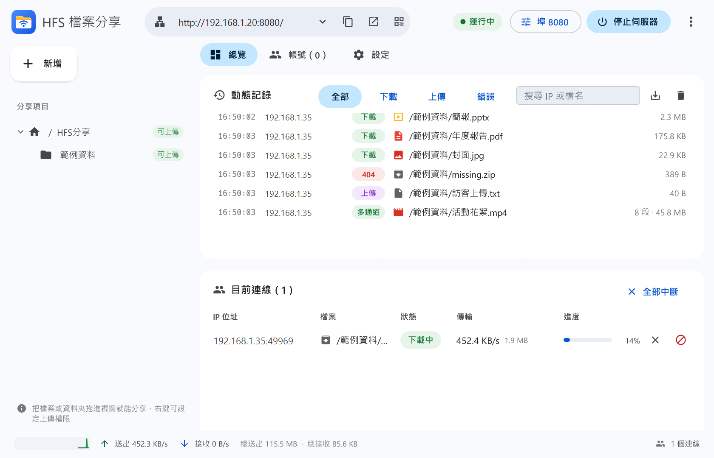
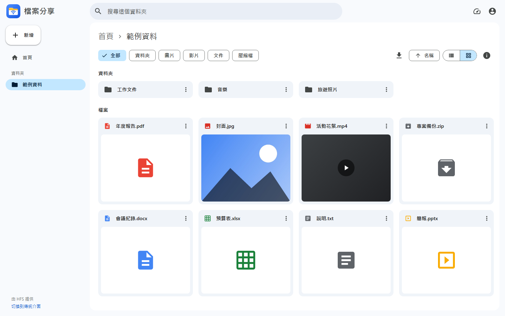
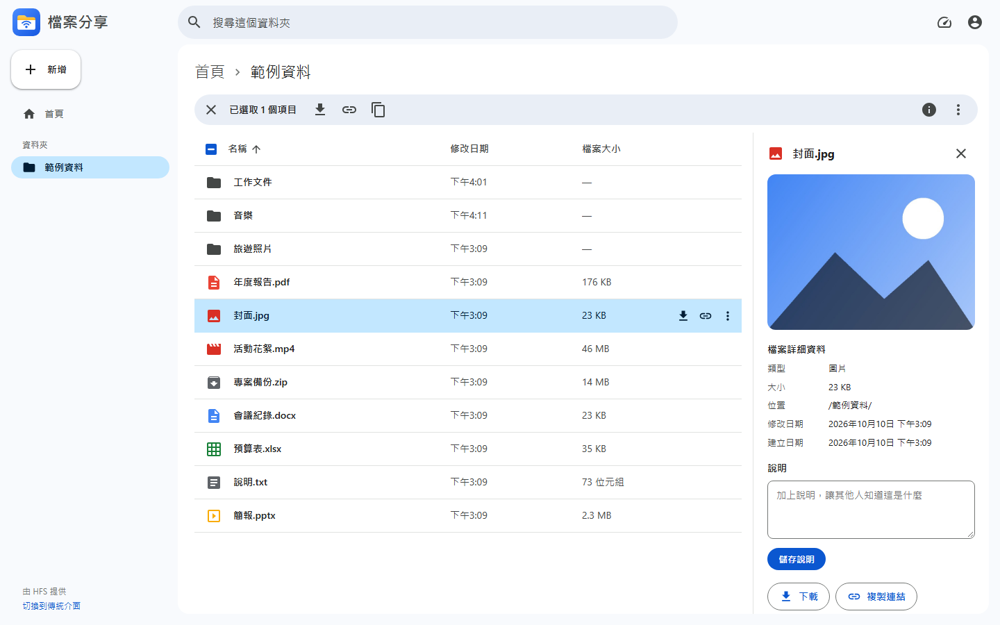
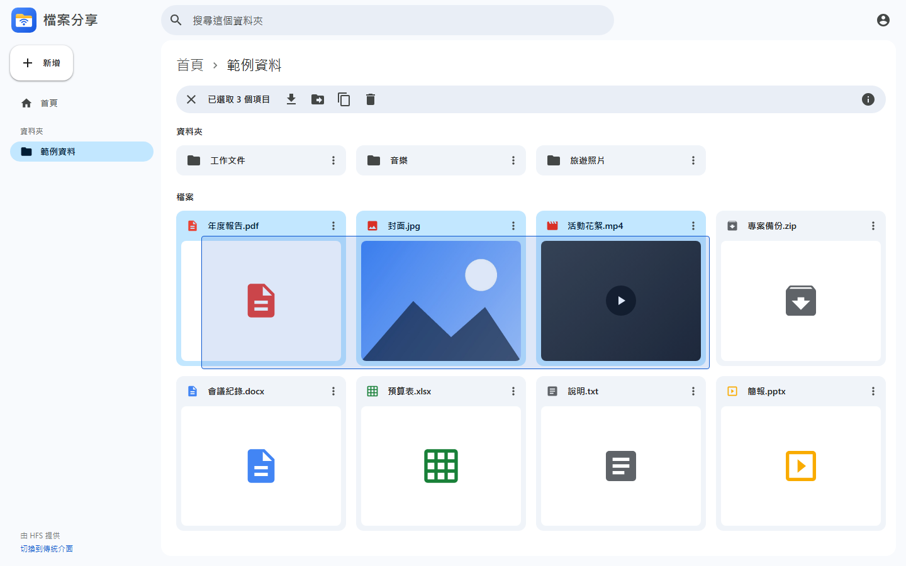
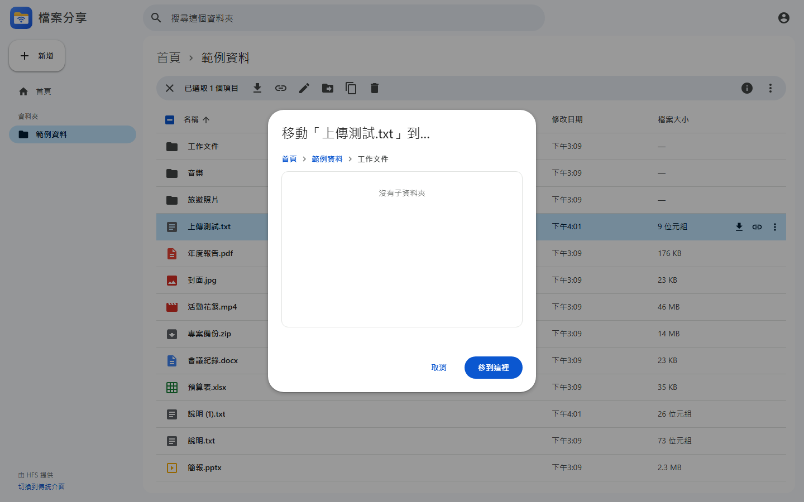
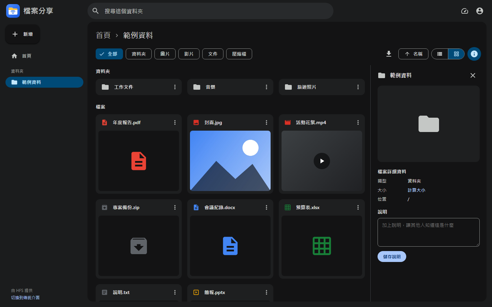
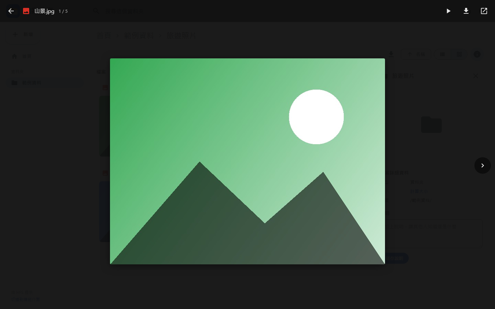
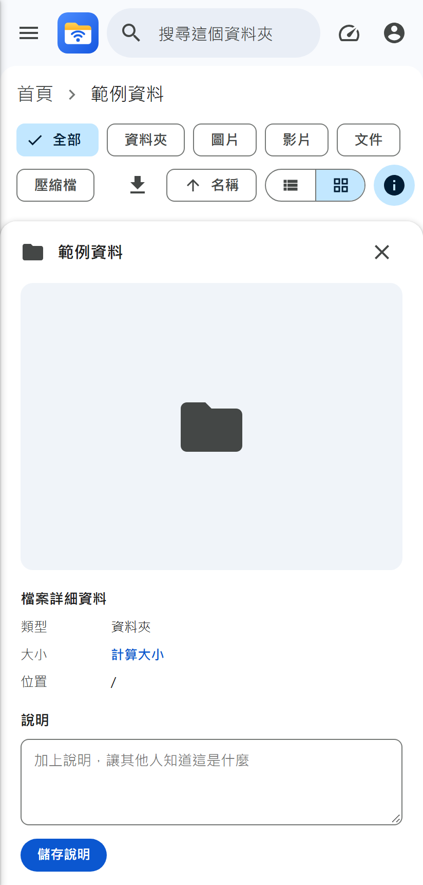
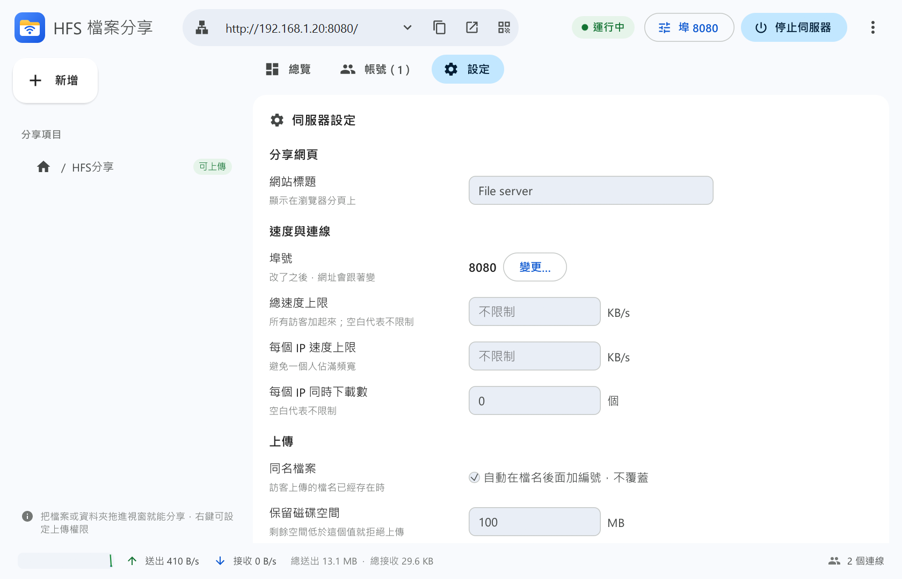

<p align="center">
  
</p>

<h1 align="center">HFS Desktop</h1>

<p align="center">
  給 <a href="https://github.com/rejetto/hfs">HFS（HTTP File Server）</a> v3 用的 Windows 桌面管理程式，<br>
  外加一套仿 Google 雲端硬碟的分享網頁。不用開瀏覽器管理，把資料夾拖進視窗就能分享。
</p>

<p align="center">
  <a href="https://github.com/win81134679-dot/hfs-desktop/releases/latest"></a>
  
  
  <a href="LICENSE"></a>
</p>

---

HFS v3 功能很強，但所有設定都要在瀏覽器裡的管理頁面操作。HFS v2 那種「開一個視窗、拖檔案進去就好」的用法，在 v3 不見了。
**HFS Desktop** 把它找回來，並把訪客看到的分享頁面換成更好用的雲端硬碟風格。

## 截圖

**桌面程式**：即時動態記錄、目前連線、流量圖



**分享網頁**：清單／格狀檢視、預覽、框選、拖曳搬移、詳細資訊

| 格狀檢視 | 詳細資訊面板 |
|---|---|
|  |  |
| **框選多個項目** | **移動到其他資料夾** |
|  |  |
| **深色模式** | **圖片預覽** |
|  |  |

<details>
<summary>更多截圖：手機版、桌面程式設定</summary>




</details>

## 功能

### 桌面程式（`hfs-gui.exe`）

- **一鍵啟動**：在背景執行 HFS，沒有黑色主控台視窗，也不會自動開瀏覽器
- **拖曳分享**：把檔案或資料夾拖進視窗就分享；左側項目樹也能拖曳整理
- **權限設定**：右鍵 →「屬性與權限」，逐項設定誰可以下載、看見、上傳、刪除。可選任何人、已登入帳號、指定帳號、只有管理員、禁止，或繼承上層
- **帳號管理**：新增、編輯、刪除帳號，設定密碼、管理員、停用
- **即時監看**：
  - 動態記錄可以篩選（下載、上傳、錯誤）、搜尋、匯出
  - 目前連線顯示進度和速度，可以中斷連線或封鎖 IP
  - 最近兩分鐘的流量圖
- **手機 QR Code**：用手機掃描就能連進分享網頁
- **系統匣**：關閉視窗時可選擇在背景繼續運行；可設定開機自動啟動
- **安裝程式**：自動建立桌面與開始功能表捷徑「HFS 檔案分享」，可從「設定 → 應用程式」解除安裝
- **伺服器設定**：網站標題、埠號、速度上限、每個 IP 同時下載數、同名檔案處理、封鎖清單
- **HFS 自動更新**：
  - 每天最多檢查一次，有新版會提醒：立即升級、稍後提醒或略過這個版本
  - 升級時會自動備份舊版，失敗就還原

### 分享網頁（HFS 外掛 `drive-ui`）

- **雲端硬碟風格**：清單或格狀檢視、圖片縮圖、類型篩選、排序、搜尋（可連同子資料夾一起找）
- **預覽**：圖片、影片、音樂、PDF、文字檔，圖片可以投影片播放
- **選取**：
  - 框選、Ctrl／Shift 多選、全選
  - 鍵盤操作：方向鍵、Enter、Delete、F2、Backspace
- **右鍵選單**：下載、複製連結、重新命名、移動到、複製到、刪除、詳細資訊
- **拖曳**：
  - 從電腦拖進來就上傳；放在資料夾上就傳進那個資料夾
  - 項目拖到資料夾就是移動
  - 拖到桌面就是下載
  - 拖著停在資料夾上會自動打開
- **上傳**：支援整個資料夾；同名檔案可選略過、保留兩者或取代；右下角顯示進度
- **多通道下載**：大檔案用多條連線同時下載，可設定 4、8 或 16 條
- **詳細資訊面板**：類型、大小（資料夾可計算）、日期、可編輯的說明
- **其他**：手機版、深色模式；所有圖示內嵌在頁面裡，區網沒有網路也能正常顯示
- 想用 HFS 原本的網頁，網址加上 `?classic` 即可

## 安裝

### 方法一：安裝程式（建議）

到 [Releases](https://github.com/win81134679-dot/hfs-desktop/releases/latest) 下載 `HFS-Desktop-Setup-v*.exe` 並執行：
- 安裝到 `%LOCALAPPDATA%\Programs\HFS Desktop\`，只裝給目前帳號，不需要系統管理員權限
- 建立開始功能表捷徑「HFS 檔案分享」，桌面捷徑可在安裝時勾選（預設勾選）
- 第一次啟動的流程和下面的單一 exe 相同（自動下載最新版 HFS、套用設定）
- 解除安裝只會移除程式本身，HFS 與設定（`%LOCALAPPDATA%\HFS Desktop\`）和分享的檔案都會保留

### 方法二：單一 exe（免安裝）

到 [Releases](https://github.com/win81134679-dot/hfs-desktop/releases/latest) 下載 `HFS-Desktop-v*.exe`，放在任何地方雙擊即可。

第一次執行時：
- 自動從 GitHub 下載**最新版** HFS（多通道下載），安裝到 `%LOCALAPPDATA%\HFS Desktop\`
- 套用雲端硬碟風格的分享網頁
- 建立預設設定：8080 埠、分享 `下載\HFS分享` 資料夾、區網可上傳

之後 HFS 有新版，程式會提醒你一鍵升級，不需要重新下載這個 exe。換成新版 exe 時，分享網頁也會自動同步更新。

### 方法三：搭配自己下載的 HFS

#### 1. 下載 HFS

到 [HFS Releases](https://github.com/rejetto/hfs/releases/latest) 下載 `hfs-windows-x64-*.zip`，解壓到任意資料夾，例如 `C:\HFS\`。

#### 2. 下載 HFS Desktop

到本專案的 [Releases](https://github.com/win81134679-dot/hfs-desktop/releases/latest) 下載 `hfs-desktop-*-windows-x64.zip`，**解壓到同一個資料夾**，覆蓋合併即可：

```
C:\HFS\
├─ hfs.exe            ← HFS 官方
├─ hfs-gui.exe        ← 本專案
└─ plugins\
   └─ drive-ui\       ← 本專案（分享網頁）
```

#### 3. 啟動

雙擊 `hfs-gui.exe`。第一次啟動會自動建立 `config.yaml`（使用 8080 埠、啟用分享網頁），之後把要分享的資料夾拖進視窗就完成了。

> **Windows 防火牆**：第一次啟動時如果跳出詢問，請勾選「私人網路」並允許，否則區網裡的其他裝置連不進來。

## 使用小提醒

| 情境 | 說明 |
|---|---|
| 自己從這台電腦開分享網頁 | 用桌面程式的「開啟」按鈕，會用 `localhost` 開，等於管理者身分，可以刪除、改名、搬移 |
| 給別人連 | 按網址列的「複製」或 QR Code，給的是區網網址 |
| 開放訪客上傳 | 在左側資料夾按右鍵 →「允許任何人上傳」，或在「屬性與權限」裡細部設定 |
| 多通道下載很佔記憶體 | 從區網 http 網址下載時，瀏覽器限制只能先放在記憶體；非常大的檔案可以在網頁右上角暫時關掉多通道 |
| 想要密碼保護 | 在「帳號」分頁建立帳號，再到「屬性與權限」指定只有這些帳號可以下載 |

## 從原始碼建置

需要 [Rust](https://rustup.rs/)（stable，MSVC 工具鏈）與 Visual Studio Build Tools。

```powershell
git clone https://github.com/win81134679-dot/hfs-desktop.git
cd hfs-desktop\hfs-gui
cargo build --release
```

把 `hfs-gui\target\release\hfs-gui.exe` 和 `hfs\plugins\drive-ui\` 複製到 HFS 資料夾即可。`hfs-gui.exe` 本身已內嵌分享網頁外掛，單獨執行也能自動下載 HFS 並完成設定。

分享網頁外掛是純 HTML／CSS／JavaScript，不需要建置；修改 `hfs\plugins\drive-ui\public\` 後重新整理網頁就會生效。重新編譯 exe 後，內嵌的外掛也會更新。

### 要公開發佈時

```powershell
powershell -ExecutionPolicy Bypass -File scripts\build-release.ps1
```

這個腳本會：
- 跑單元測試
- 用 `--remap-path-prefix` 把本機路徑（Windows 使用者名稱、專案資料夾）從 exe 裡移除
- 建置後掃描 exe，確認沒有殘留本機路徑才打包；有殘留就停止
- 打包到 `dist\`；有裝 [Inno Setup 6](https://jrsoftware.org/isinfo.php) 時一併產生安裝程式（`scripts/installer.iss`）

一般的 `cargo build` 會把建置機器的路徑寫進 exe，**不適合直接公開發佈**。

## 專案結構

```
hfs-gui/                 桌面程式（Rust + egui）
├─ src/
│  ├─ main.rs            進入點、單一執行個體
│  ├─ server.rs          管理 hfs.exe 子程序、呼叫 HFS 管理 API、即時資料（SSE）
│  ├─ updater.rs         查 GitHub 新版、多通道下載、解壓縮
│  ├─ embedded.rs        內嵌的分享網頁外掛與預設設定（單一 exe 模式）
│  ├─ ui.rs              主視窗
│  ├─ ui/admin.rs        帳號、設定、屬性與權限
│  ├─ ui/update.rs       更新提醒與進度
│  ├─ theme.rs           配色、字型、圖示、自繪元件
│  ├─ prefs.rs           介面偏好、開機自動啟動
│  └─ api.rs / win.rs    HTTP 與 Win32 小工具
└─ assets/               Logo（SVG／PNG／ICO）
hfs/plugins/drive-ui/    分享網頁外掛（取代 HFS 預設前端）
hfs/config.example.yaml  設定範例
scripts/build-release.ps1  發佈用建置（移除本機路徑＋掃描＋打包）
scripts/installer.iss      安裝程式（Inno Setup，建立捷徑）
```

### 運作方式

- 桌面程式在背景啟動 `hfs.exe`，透過 `http://127.0.0.1:<port>/~/api/` 呼叫 HFS 的管理 API。HFS 對本機請求預設免密碼，所以不需要設定管理員帳號。
- 即時記錄、連線和流量，是用 HFS 的 SSE 串流取得的。
- 分享網頁外掛：在 HFS 決定送出前端頁面時，換成自己的頁面。權限、登入、傳輸仍由 HFS 處理。

## 授權

本專案以 [GPL-3.0](LICENSE) 授權釋出。第三方元件與致謝見 [NOTICE.md](NOTICE.md)。

本專案為非官方工具，與 HFS 作者 [rejetto](https://github.com/rejetto) 無關。感謝 HFS 提供這麼好用的檔案伺服器。
